# E5 OpenWrt 刷机包 · 深度休眠版（e5-sleep）

容悦 E5（展锐 UMS9621）的 OpenWrt 一键刷机包：上游 [e5-linux](https://github.com/sprd-linux-devs/e5-linux) 从源码完整重建的系统，
加上[深度休眠内核](https://github.com/CharlesGool/e5-sleep-kernel)、系统化的信息屏功能和 LuCI 网页升级。**非官方修改版，只适用于 E5。**

*An unofficial one-click OpenWrt flash package for the Rongyue E5: the system rebuilt from upstream e5-linux, the
[deep sleep kernel](https://github.com/CharlesGool/e5-sleep-kernel), the info-screen extras built in, and updates from LuCI.*

## 下载

**当前版本 e5-sleep8**：[Openwrt_E5_Flasher_sleep8.zip](https://github.com/CharlesGool/e5-openwrt-flasher/releases/download/e5-sleep8/Openwrt_E5_Flasher_sleep8.zip)
（167 MB，[Release 页面](https://github.com/CharlesGool/e5-openwrt-flasher/releases/tag/e5-sleep8)）

SHA-256 `029bd2bc86a70eee276e57231c0f6fd18bf73acf4b980191738682da830c1d2e`

## 待机功耗

**深度休眠约 9 mA，即 36–39 mW**（e5-sleep8 过夜实测：射频关闭、热点关闭、熄屏）。
原版刷机包同样熄屏、关热点约 **1 W**（系统不会休眠），待机功耗降到原来的约 1/25。


- 功率监测的 24 小时平均：深度休眠 39 mW，共 518 分钟，一夜电量 80% → 78%。
- 电量计自己的休眠校准也测得约 9 mA（3999 mV，一次睡了 2 小时 16 分钟）。
- 一夜只挂起了 8 次，每次都进入 AP 深睡和芯片级休眠。
- 对比：原版约 1 W（不休眠）→ e5-sleep2 约 73 mW（AP 深睡）→ e5-sleep8 约 39 mW（芯片级休眠）。
- 详细数据和分析见 [e5-sleep-kernel 的「功耗」](https://github.com/CharlesGool/e5-sleep-kernel#功耗)。

## 相对原版刷机包的改动

“原版”指官方 Openwrt_E5_Flasher（2026-10-13，e5-linux `359ae54`，内核 `6.18.54-e5-mobile4`）。e5-sleep8 相对它的全部改动：

### 1. 系统：按上游新版从源码重建

- **上游 e5-linux `bb8775e`（2026-10-16）**，比原版新三天：Wi-Fi、基带、短信、信息屏的修复，以及内核侧的显示、eMMC DMA、EIC、温度、SIPA、电量计、Wi-Fi SAE 适配。
  OpenWrt 25.12.5、ModemManager 1.24.0-r930、BlueZ、信息屏 `1ca4d58`；镜像版本显示为 `bb8775e+e5-sleep8`。
- **WPA3（SAE）热点能用**：上游构建脚本编 hostapd 时，SAE 的源码改动会在重新 prepare 时被冲掉，wpad 不认识 `unisoc_sae`，WPA3 热点起不来。
  这里改成 hostapd 的包补丁（每次 prepare 都会打上），构建时还检查 wpad 二进制里确实有这项改动。
- **软件包**：
  - 去掉 PPPoE 拨号（ppp-mod-pppoe、luci-proto-ppp 等；`ppp` 本体留着，ModemManager 要用）和用不上的 armsr GRUB EFI 引导；
  - **内置 SFTP 服务**（openssh-sftp-server），WinSCP、FileZilla 可以直接用 SFTP 连。

### 2. 内核：深度休眠（`6.18.54-e5-sleep8-charles`）

官方 E5 内核构建流程（linux-lts-e5 `020b970`，加上游 bb8775e 的内核适配）加 9 个补丁。
`boot.img` 以官方的为底，只换内核和 initramfs 里的 45 个模块；init、busybox、f2fs 工具逐字节不变。

| 补丁 | 作用 |
|---|---|
| 0001 | PMIC 看门狗在系统挂起时停表：否则挂起中会被看门狗复位，用户态深度休眠没法用 |
| 0002 | 修正显示驱动挂起时的 WARNING |
| 0003 | 打开 CPU 空闲状态（cpuidle），亮屏待机更省电 |
| 0004 | 挂起时关闭 GPU 电源域（原来只在启动时上电，挂起也不断电） |
| 0005 | 相机电源域驱动：开机即关（原来一直被引导程序留着上电）。0004 和 0005 让 AP 挂起时进入 PMU 深睡 |
| 0006 | 挂起时释放 USB PLL：原来 USB 驱动一直强制开着它，整颗芯片进不了芯片级休眠（关晶振、降压） |
| 0007 | USB 数据关闭时，USB 状态机不再每 200 ms 空转、打日志 |
| 0008 | 电量计休眠校准原来每 2320 秒把设备唤醒一次，改为约 9 小时一次（模块参数 `relax_cnt_threshold`，默认 8191，写 0 恢复原值） |
| 0009 | USB 数据关闭时，插着线也能挂起（原来插着线就永远不休眠） |

补丁、构建方法和测试数据在 [e5-sleep-kernel](https://github.com/CharlesGool/e5-sleep-kernel)。

### 3. 休眠与充电

- **预装[热点省电](https://github.com/CharlesGool/e5-hotspot-saver) 3.0**：
  - 熄屏、关热点、射频已关时，挂起到内存深度休眠（挂起前后自动处理看门狗）；
  - CPU 关闭核心；
  - 能识别电量计校准唤醒；
  - USB 角色可选「关闭（仅充电）」和 **「关闭（不充电）」**。后者把数据和充电都关掉，整机由电池供电，配合 0009 插着线也能深度休眠，适合长期插在电源上的设备。
- **充电保护** 新增强制停充（`e5-charge` 的 `block` 选项），「关闭（不充电）」用的就是它。

<p>
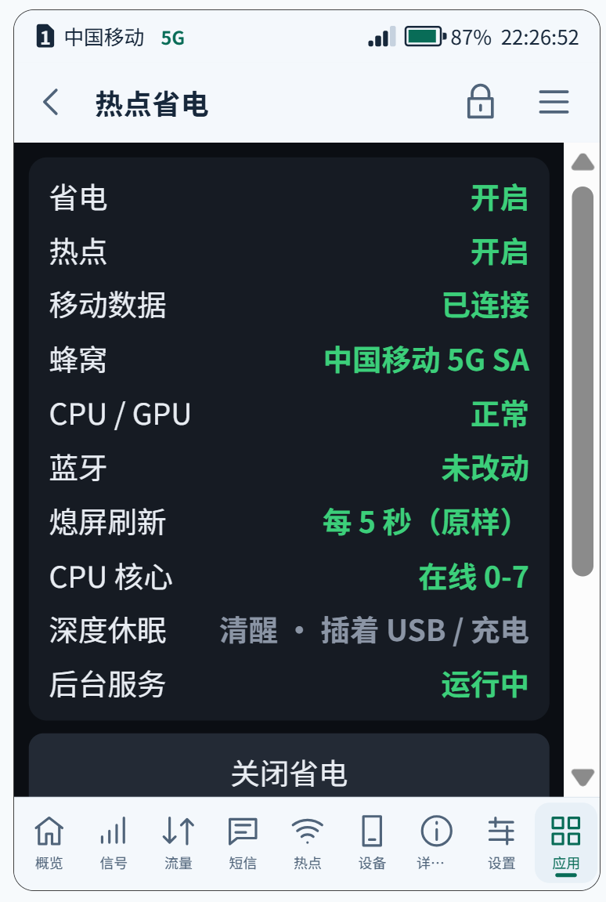
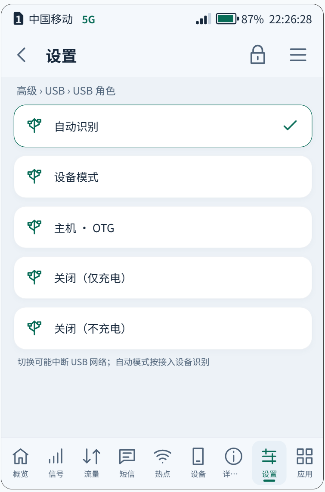
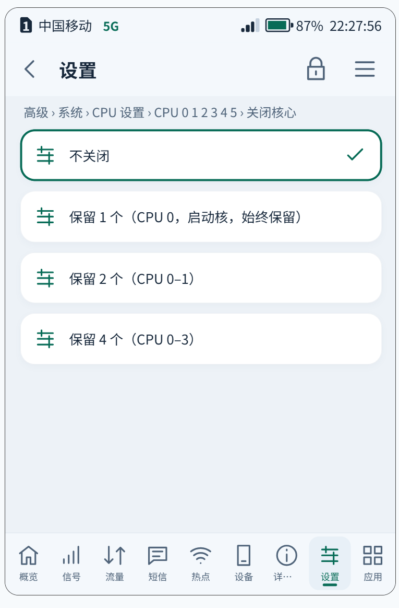
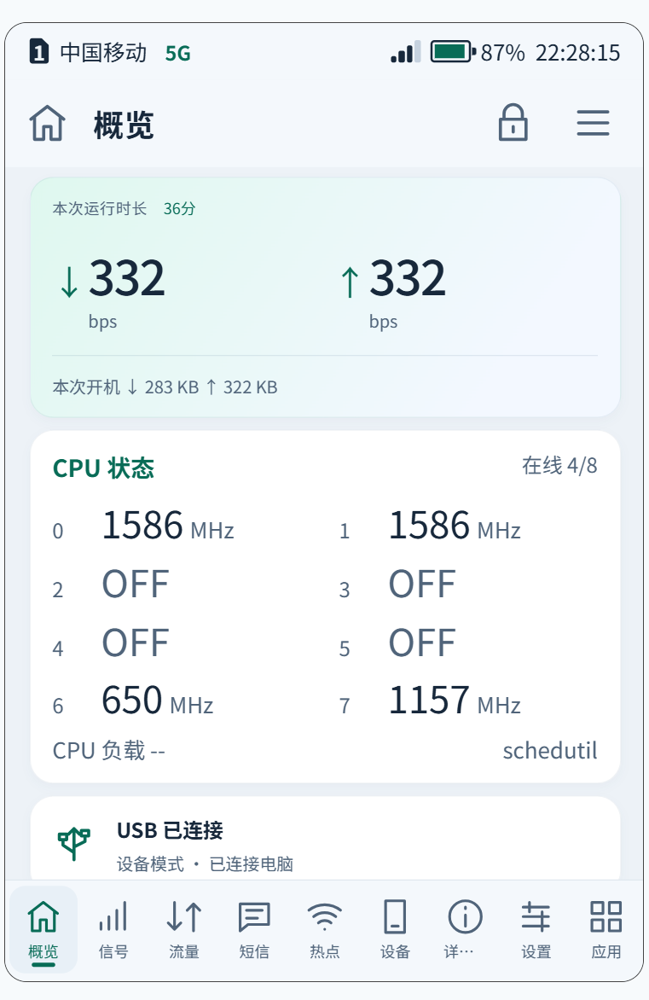
</p>

*热点省电 · USB 角色（新增「关闭（不充电）」）· CPU 关闭核心 · 关闭核心后概览里的 CPU 状态*

### 4. 系统功能（原来是要另装的应用，现在内置）

| 功能 | 版本 | 说明 |
|---|---|---|
| 音量键 | 1.5 | 音量键调亮度，最低亮度再按音量 − 关闭屏幕；熄屏后屏蔽其他按键，只有音量 + 唤醒（内核模块 e5_keywake） |
| 侧键开关热点 | 1.3 | 长按侧键开关热点，熄屏、按键锁定时也能用；长按时间、震动可调 |
| 功率监测 | 1.4 | **在「详细信息」页**：当前功率；耗电与电量曲线（30 分钟 / 6 小时 / 24 小时）；本次充电；24 小时各状态平均。配色随亮色 / 暗色主题。插着电但没在充电（充电保护停充、充满后停充）时，按电池供电计入耗电，不再误报“充电器供电不够”。数据每 10 分钟存到 `/etc/e5/powermon`，重启、升级后保留。完整曲线和 CSV 在 LuCI「状态 → 功率监测」 |
| 底部导航 | 1.5 | 9 个 / 5 个入口；切换后导航栏立即重排；LuCI「服务 → 信息屏应用 → 底部导航」显示并可修改当前模式 |
| 禁用 IPv6 | — | 原 noipv6 应用，现在是「高级 → 网络」最下面的一个开关（移动网络只申请 IPv4，DNS 不返回 IPv6；默认开）。从装了 noipv6 应用的系统升级时，自动换成内置版，设置保留 |

- 这几项不出现在应用界面、应用管理和 LuCI 的应用列表里，不能卸载，也不用单独安装。
- 它们的设置按功能放进「高级」：
  - **按键**：新分类，在“屏幕”之后，包括侧键和音量键；
  - **界面与锁屏**：底部导航；
  - **充电**：功率监测采样间隔。
- 界面补丁在镜像里已经打好，首次开机不会再重启屏幕。

<p>
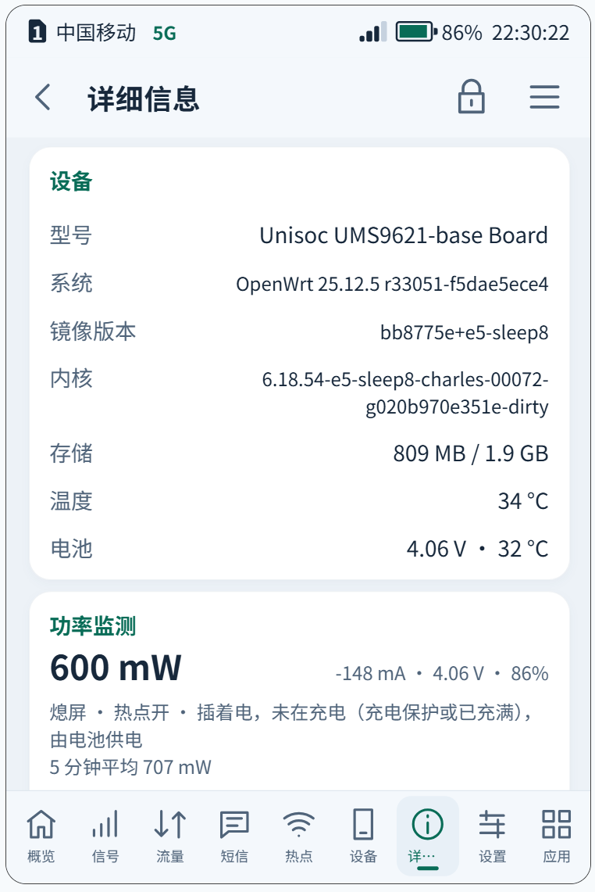
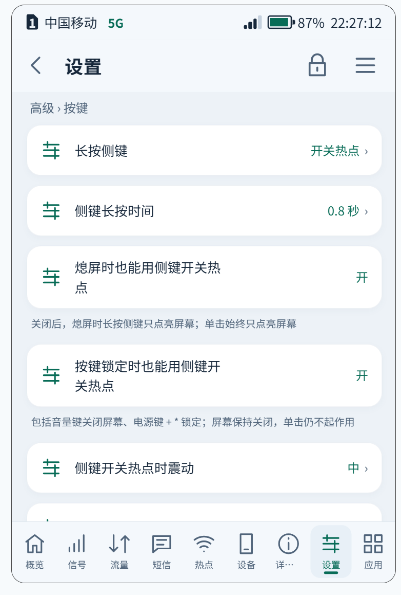

</p>
<p>
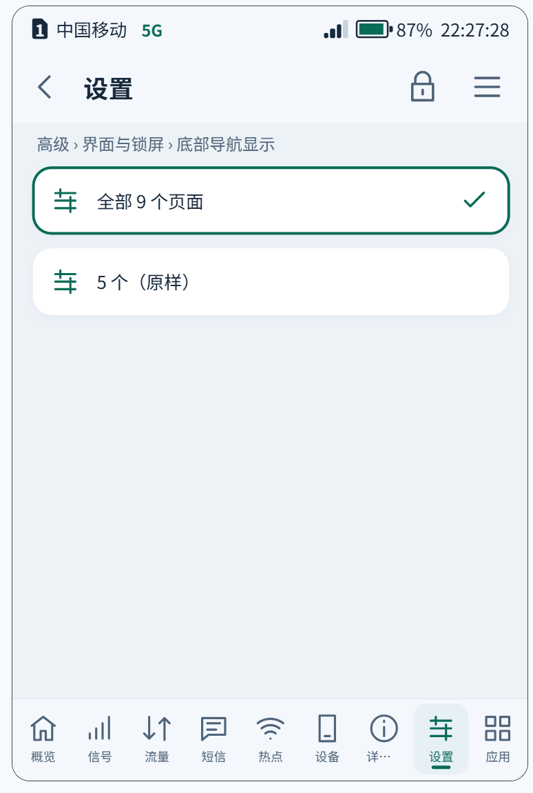
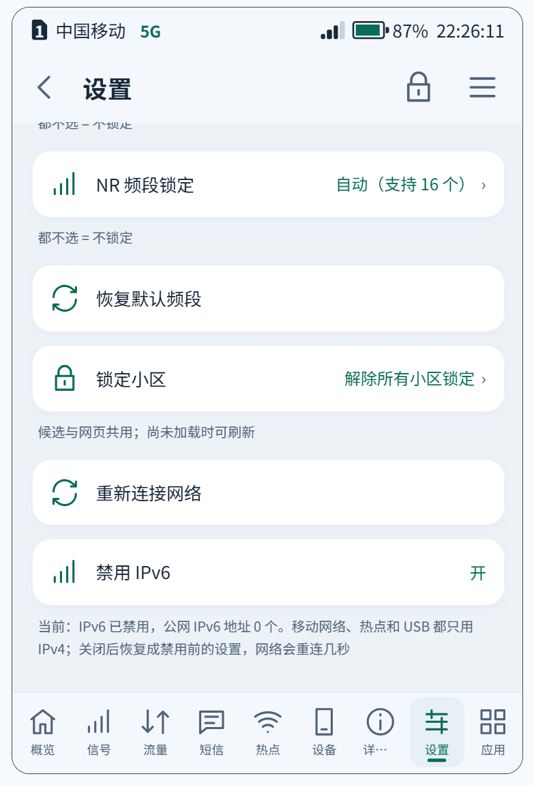
</p>

*「详细信息」页的功率监测（插着电但没在充电时按电池供电计入）· 高级 → 按键（侧键、音量键）· 底部导航 9 个 / 5 个 · 禁用 IPv6 开关*

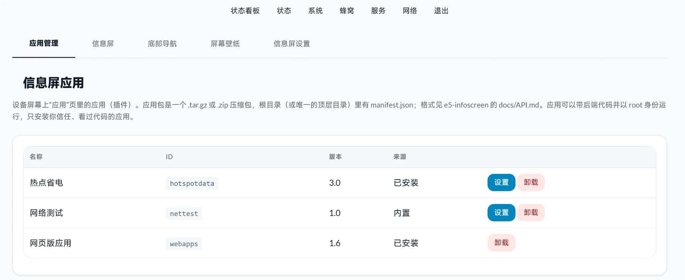

*LuCI 应用管理：四个系统功能不再出现在应用列表里，只剩热点省电、网页版应用和上游内置的网络测试*

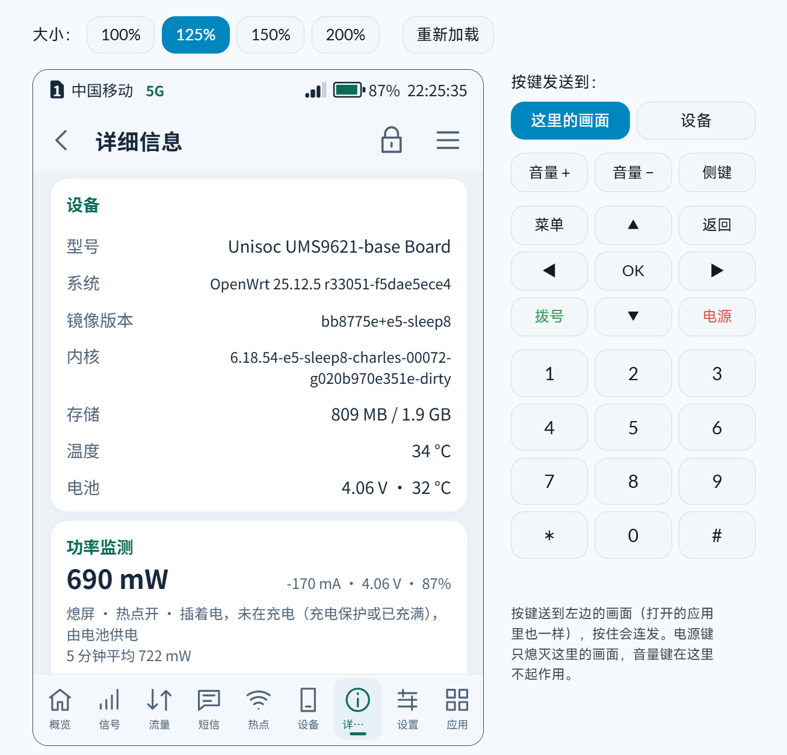

*LuCI 的信息屏远程画面里同样能看到功率监测卡片*

### 5. 信息屏

- 独立分支：**去掉在线更新**（高级 → 系统 里的检查更新 / 回退、概览的更新提示、LuCI 的上传更新），免得被官方版本覆盖。
- **关于** 页写明原作者 Enceka 和修改版维护者 CharlesGool，赞赏下面加了本修改版的 GitHub 二维码。
- 修正原版界面的一个问题：底部导航的指示条在连续点击时会跳起来。
- SIM 状态时间戳改用 CLOCK_BOOTTIME，休眠之后时间不会错乱。
- 预装[网页版应用](https://github.com/CharlesGool/e5-webapps) 1.6。

### 6. 升级

- **网页升级**：在 LuCI「系统 → E5 系统升级」上传这个 zip，系统会自动解压、按 SHA256SUMS 校验、检查机型，再按 `flash.cmd --update` 的步骤写 boot_b、换系统镜像，然后点「立即重启」，**不再需要电脑**。
  刷机包存在 userdata 里，不占内存；空间不够时会先提示，不会只写一半。
  「备份 / 升级」里的「刷写新的固件」已停用（那是 armsr 通用版 sysupgrade，会刷坏 E5），配置备份照常能用。

  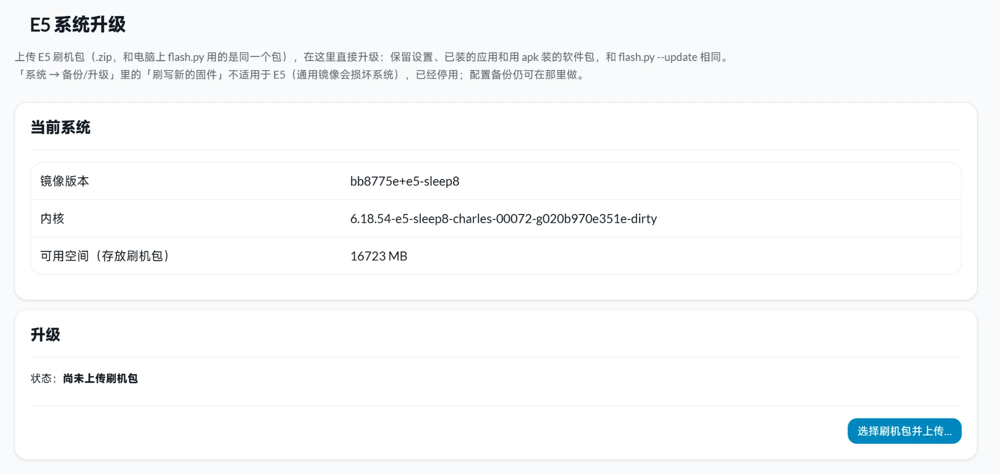
- **升级保留更多数据**（网页升级和 `--update` 相同）。原版保留 `/etc/config`、密码、SSH 密钥、`/etc/e5`、vnstat、短信、信息屏应用，这里另外保留：
  - **用 apk 另装的软件包**（如 OpenClash）：新旧系统是同一个 OpenWrt 版本时，连同文件、数据库、`/etc` 下它们的目录和已启用的服务一起带过去；版本不同时，包名记在 `/etc/e5/apk-carry.list`，方便重装。被你替换掉的自带包（如 dnsmasq → dnsmasq-full）随之去掉；本包有意去掉的 PPPoE、GRUB 不会被带回来；
  - **流量统计和短信转发设置**（`/etc/unisoc-modem`）：原版每次升级都会清零；
  - **OpenWrt 标准保留清单**（各软件包的 `/lib/upgrade/keep.d` 和 `/etc/sysupgrade.conf`）：蓝牙配对、计划任务、dnsmasq.d、nftables.d、rc.local、sysctl.conf、hosts 等；
  - 功率监测的历史数据。
- **卸载过的应用不会被装回来**：原版每次升级都会把自带的“电话”装回去；这里卸载过的应用记在 `/etc/e5-infoscreen/removed-apps`，升级时跳过。
- 从 Android 切回 OpenWrt 要用本包的 `--boot-openwrt`（或 Magisk 切回模块）：原版包会因 boot_b 的哈希不同而拒绝。

更详细的说明见包内 [README.zh-CN.md](package/README.zh-CN.md)（English: [README.md](package/README.md)）。

## 已知问题

- USB「关闭（不充电）」切换后，数据立即关闭，但要等约 30 秒才真正停充。
- 禁用 IPv6 时，ModemManager 建的 `wan_6` 接口会反复重试 DHCPv6，系统日志较多，不影响使用。
- 插着线深度休眠（0009）还没有做长时间实测。

## 用法

和官方刷机包相同：

- **新装**（Android 下，Magisk root，USB 调试）：解压后运行 `flash.cmd`（Windows）或 `./flash.sh`；不插 SD 卡、装到手机存储用 `flash.cmd --data`。
- **升级**（OpenWrt 运行中）：
  - e5-sleep8 起：LuCI「系统 → E5 系统升级」上传 zip → 等“已校验” → 开始升级 → 立即重启；
  - 或电脑上 `flash.cmd --update`（USB 连着）。
- **从 Android 切回 OpenWrt**：`flash.cmd --boot-openwrt`，或 Magisk 切回模块。

刷机有风险，请先备份，风险自负；与荣悦及设备、芯片厂商无关。

## 版本

| 版本 | 下载 | 说明 |
|---|---|---|
| **e5-sleep8** | [本仓库 Release](https://github.com/CharlesGool/e5-openwrt-flasher/releases/tag/e5-sleep8) | 网页升级；USB 关闭（不充电）与插线深度休眠；升级保留流量统计等用户数据；功率监测修正 |
| e5-sleep4 | [本仓库 Release](https://github.com/CharlesGool/e5-openwrt-flasher/releases/tag/e5-sleep4) | 官方 2026-10-13 包 + 内核 0001–0007（芯片级休眠） |
| e5-sleep2 | [本仓库 Release](https://github.com/CharlesGool/e5-openwrt-flasher/releases/tag/e5-sleep2) | 官方 2026-10-13 包 + 内核 0001–0005 |

（e5-sleep5–7 是 e5-sleep8 之前的中间版本，没有公开发布。）

## 自己做刷机包

需要 x86_64 Linux + Docker（arm64 用 qemu-user-static）。大致流程（e5-sleep8）：

1. **内核**：[e5-sleep-kernel](https://github.com/CharlesGool/e5-sleep-kernel) 的 `build/build-e5.sh sleep8 -e5-sleep8-charles 6`，
   再用 e5-linux `upstream/stage-root-modules.py` 生成 `root-modules.tar`。
2. **上游系统**：检出 e5-linux `bb8775e`（含子模块），打上 [upstream/e5-linux-bb8775e.patch](upstream/e5-linux-bb8775e.patch)
   （BlueZ 在 x86 主机上编、`E5_FEATURES` 接受 `-e5-sleepN` 内核、hostapd 的 SAE 源码改动做成包补丁、构建时可用镜像源和 apk 缓存），
   恢复 CI 引导输入（`tools/ci-inputs.py restore`），然后：

   ```sh
   bash openwrt/build-modemmanager.sh && bash openwrt/build-bluez.sh
   E5_FEATURES=1 E5_DOCKER=0 E5_IMAGE_MB=2048 E5_ROOT_MODULES=.../root-modules.tar E5_ROOT_MODULES_ONLY=1 \
     E5_STANDALONE=1 E5_DEVICE_FILES=0 [E5_WRT_MIRROR=https://mirrors.ustc.edu.cn/openwrt] bash openwrt/build-rootfs.sh
   ```

3. **后处理**：[build/make-rootfs-sleep8.sh](build/make-rootfs-sleep8.sh)：删 PPPoE / GRUB、加 SFTP；
   [patch-infoscreen-sleep5.py](build/patch-infoscreen-sleep5.py) 到 [sleep8](build/patch-infoscreen-sleep8.py) 依次改信息屏；
   [builtin-apps-sleep6.py](build/builtin-apps-sleep6.py) 把四个应用做成系统功能；[overlay/](overlay) 是加进系统的文件；预装应用；改 SIM 状态时间戳。
4. **启动镜像**：[build/repack-boot.py](build/repack-boot.py) 以官方 boot.img 为底，只换内核和 initramfs 里的模块。
5. **组装**：以官方刷机包为底，换 `files/boot.img`、`files/openwrt.ext4.gz`、`files/boot.json`、`files/VERSION`、`SHA256SUMS`，
   以及 [package/device-install-image.sh](package/device-install-image.sh)（升级时保留软件包和用户数据）。

[tests/](tests) 是在镜像副本里（chroot）跑的检查：设置归组、内置应用隐藏、IPv6 开关、卸载记录、网页升级接口等。

## 许可

脚本为 MIT；刷机包源自 e5-linux（MIT，Enceka），其中的 Linux 内核为 GPL-2.0。见 [LICENSE](LICENSE)。
